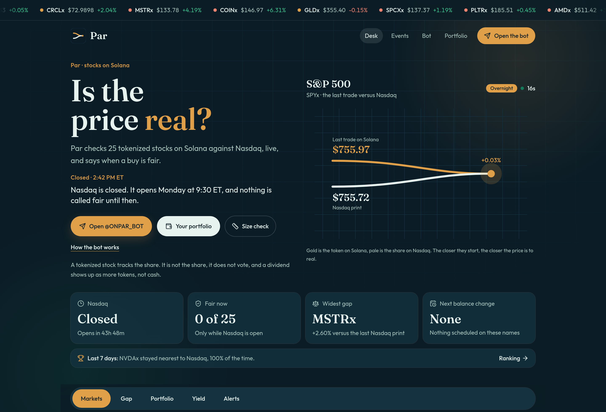
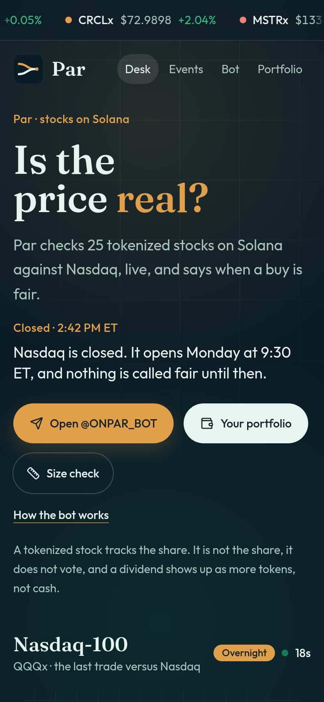

# Par (onpar.site)

Live check of tokenized stocks on Solana against the Nasdaq print, with a public web desk and a Telegram bot.

**Live:** [https://onpar.site](https://onpar.site) · Bot: [@ONPAR_BOT](https://t.me/ONPAR_BOT)

Par tracks 25 tokenized stocks (19 xStocks and 6 Backpack Securities tokens). For each name it shows a live price on Solana, a quoted $1,000 buy, the Nasdaq print, the gap, and whether that buy is fair.

## Screenshots

| Desktop | Phone |
| --- | --- |
|  |  |

## Features

- **Desk.** A card per name: last trade on Solana, a $1,000 buy priced per share, the Nasdaq print, the gap, and a verdict. A running tape shows the names.
- **Size check.** What an order of a chosen dollar size actually costs, from a live Jupiter quote, including the gap to the Nasdaq print.
- **Pages.** One page per name (`/s/NVDAx`), plus Events, a weekly ranking of which names stayed closest to Nasdaq, a bot page, and a portfolio page.
- **Portfolio.** A public Solana address, valued per share, with exit quotes, a map of the bag, lending rates, and a link that asks the bot to watch that bag.
- **Venues and supply.** Where a name trades (Kraken for xStocks, Backpack Exchange for Backpack tokens) and how supply on Solana changes.
- **Telegram bot.** The same desk in chat: `/prices`, `/size`, `/portfolio`, `/yield`, `/events`, `/week`, `/flows`, one-off alerts, and holder tools (morning brief, open bell, Fair pings) after a wallet signs a plain message on the site. That signature is not a transaction and cannot move funds.

## Tech stack

Taken from `package.json` and the source. Two apps, one repo.

**Telegram bot** (`package.json`, Node 18+)

- TypeScript, run with `tsx` in development and `tsc` for the build
- [Telegraf](https://telegraf.js.org/) for Telegram
- `@solana/web3.js` and `@solana/spl-token`
- Jupiter Price API (`api.jup.ag` with a key, `lite-api.jup.ag` without one)
- `better-sqlite3` for users, alerts, and price history
- `axios`, `zod`, `dotenv`, `node-cron`

**Website** (`site/package.json`, Node 22.12+)

- [TanStack Start](https://tanstack.com/start) and TanStack Router, React 19
- Vite 8 and Tailwind CSS 4
- Netlify (Vite plugin, Functions, Edge Functions, Blobs)
- `recharts` for the gap chart, `lucide-react` for icons

## Architecture

```
Browser  ──►  site/   TanStack Start on Netlify
                 │     desk, portfolio, events, ranking, wallet proof
                 │
                 ├── Jupiter, Nasdaq quote API, Solana RPC
                 ├── Kraken and Backpack public market APIs
                 ├── Kamino reserve metrics, SEC EDGAR, GeckoTerminal
                 └── Netlify Blobs (gap history, shared buy quotes)

Telegram ──►  src/    long-running Node process (Telegraf)
                 │     same prices, alerts, holder pings
                 ├── SQLite (data/bot.db)
                 └── optional POST of fresh $1,000 buys to the site
```

The bot and the site quote independently. If `SHARE_BUYS_SECRET` is set to the same value in both places, the bot posts its buy quotes to the site's edge function so the desk can show them immediately. The secret is compared in constant time and is never written to the repo.

Prices are per share. Wallet balances and Jupiter's dollar price already include a token's multiplier (splits and reinvested dividends). Swap quotes are converted with the mint's scale so the gap is against the Nasdaq print of one share.

Default Solana RPC is the public mainnet endpoint. A private RPC URL belongs in the environment, because the URL can contain an API key. Server logs strip anything that looks like an address and do not print the RPC URL.

## Run it locally

**Bot**

```bash
npm install
cp .env.example .env
# Edit .env and set TELEGRAM_BOT_TOKEN (from @BotFather). Leave other keys empty to use public endpoints.
npm run dev     # tsx watch
npm test
npm run build && npm start
```

`.env.example` lists every variable the bot reads. Only `TELEGRAM_BOT_TOKEN` is required. `JUPITER_API_KEY` and `BIRDEYE_API_KEY` can stay empty. Do not commit `.env`.

**Website**

```bash
cd site
npm install
npm run dev     # http://localhost:3000
npm test
npm run typecheck
npm run build
```

The site starts with no secrets. These variables are optional and use the same names as the bot: `SOLANA_RPC_URL`, `JUPITER_API_KEY`, `TOKEN_MINT`, `HOLDER_MIN_TOKENS`, `SHARE_BUYS_SECRET`. On Netlify they are set in the project environment (Functions scope for the secret and the Jupiter key), not in git.

## Author

**Filipe Fernandes**, self-taught developer.

LinkedIn: [https://www.linkedin.com/in/filipe-agnelo/](https://www.linkedin.com/in/filipe-agnelo/)
